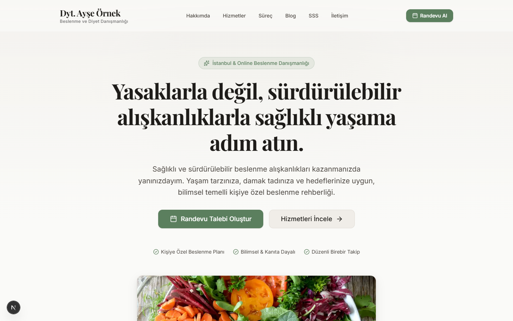
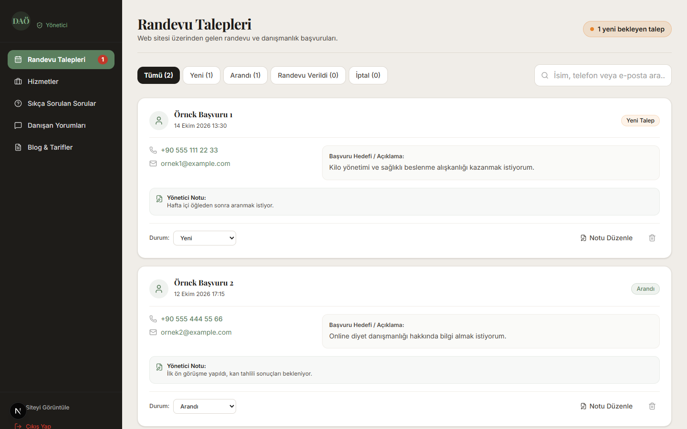

# Uzman Diyetisyen Tanıtım ve Randevu Sitesi

> **⚠️ Önemli Not:** Bu proje bir prototiptir. Veritabanı ve e-posta entegrasyonu bulunmamaktadır; randevu talepleri ve yönetim paneli verileri tarayıcı hafızasında (`localStorage`) saklanmaktadır. Canlıya almadan önce bir veritabanı (ör. Supabase) bağlanmalıdır.

Kişiye özel beslenme danışmanlığı, online diyet ve randevu yönetimi için geliştirilmiş, mobil öncelikli ve modern bir web uygulaması prototipi.

---

## 📸 Ekran Görüntüleri

| Ana Sayfa | Yönetim Paneli |
| :---: | :---: |
|  |  |

---

## 🚀 Özellikler

### Public Web Sitesi
- **Hero Bölümü**: Değer önerisi, kademeli giriş animasyonu, "Randevu Al" ve "Hizmetleri İncele" butonları.
- **Hakkımda**: Diyetisyen profil kartı, biyografi metni ve yaklaşım felsefesi.
- **Hizmetler**: 6 adet uzmanlık alanı, ikonlar, özellik maddeleri ve hover efektleri.
- **Danışmanlık Süreci**: 4 adımlı süreç akışı (İlk Görüşme, Kişisel Plan, Uygulama & Takip, Hedef Değerlendirme).
- **Blog & Tarifler**: Ana sayfada son yazılar önizlemesi, `/blog` listesi ve Markdown ile render edilen `/blog/[slug]` tekil yazı sayfaları.
- **Danışan Yorumları**: Onaylanan yorumların listelendiği dinamik alan.
- **Sıkça Sorulan Sorular**: Erişilebilir, klavye uyumlu akordeon bileşeni.
- **Randevu & İletişim Formu**:
  - İstemci ve sunucu (Server Action) doğrulaması.
  - Türkiye telefon formatı kontrolü.
  - Honeypot ile temel bot koruması.
  - Zorunlu KVKK onayı.
  - Gönderilen talepler tarayıcı store'u üzerinden anında `/admin` paneline yansıtılır.
- **KVKK Aydınlatma Metni**: `/kvkk` sayfasında bilgilendirme metni.
- **SEO & İndeksleme**: Prototip ve test aşamasında arama motoru dizinlerine düşmemesi için tüm site `noindex` olarak yapılandırılmıştır.

### Yönetim Paneli (`/admin`)
- **Demo Giriş Ekranı**: Panel yapısını test etmeye uygun sade arayüz.
- **İstemci Store (Zustand + `localStorage`)**:
  - Test sırasında eklenen durumlar, notlar ve yeni form başvuruları tarayıcıda saklanır.
- **Randevu Talepleri Yönetimi**:
  - Durum sekmeleri (`Tümü`, `Yeni`, `Arandı`, `Randevu Verildi`, `İptal`) ve sayaçlar.
  - Arama kutusu (isim, telefon, e-posta, hedef).
  - Durum güncelleme ve not düzenleme modalı.
- **İçerik Yönetimi**:
  - Hizmetler, SSS, Danışan Yorumları ve Blog yazıları için listeleme, düzenleme ve ekleme arayüzü.

---

## 🛠️ Teknoloji Yığını

- **Framework**: [Next.js 16](https://nextjs.org/) (App Router, Server Components, Server Actions)
- **Dil**: TypeScript
- **Stil**: Tailwind CSS v4 (`@theme inline` token mimarisi)
- **Tipografi**: Playfair Display (başlıklar) + Inter (gövde) — `next/font/google`
- **Animasyon**: Framer Motion (yalnızca `transform` ve `opacity`, CLS ≈ 0)
- **Form & Doğrulama**: Zod
- **İstemci Durum Yönetimi**: Zustand + `persist` (`localStorage`)
- **İkonlar**: Lucide React + Inline SVG
- **Markdown**: `react-markdown` + `remark-gfm`

---

## 📦 Kurulum ve Çalıştırma

### Gereksinimler
- Node.js 18.18 veya üzeri
- npm, pnpm veya yarn

### 1. Depoyu İndirin ve Bağımlılıkları Kurun
```bash
cd diyetisyen
npm install
```

### 2. Ortam Değişkenleri
Kök dizindeki `.env.example` dosyasını `.env.local` olarak kopyalayın:
```bash
cp .env.example .env.local
```

### 3. Geliştirme Sunucusunu Başlatın
```bash
npm run dev
```
Tarayıcınızda [http://localhost:3000](http://localhost:3000) adresine gidin.
Admin paneline erişmek için: [http://localhost:3000/admin](http://localhost:3000/admin)

### 4. Prodüksiyon Derlemesi ve Testi
```bash
npm run build
npm run start
```

---

## ☁️ Vercel'e Dağıtım (Deployment)

1. Projeyi bir GitHub / GitLab deposuna push'layın.
2. [Vercel Dashboard](https://vercel.com/dashboard)'a gidin ve **"Add New Project"** seçeneğini tıklayın.
3. Proje deposunu içe aktarın (Import).
4. **Environment Variables** bölümüne:
   - `NEXT_PUBLIC_SITE_URL`: `https://sitenizin-adi.vercel.app` (veya özel alan adınız)
5. **Deploy** butonuna basın. Uygulama otomatik olarak optimize edilip yayınlanacaktır.

---

## 🗄️ Supabase'e Geçiş Kılavuzu (Adım Adım)

Bu prototip, tüm veri erişim işlemlerini tek bir katmanın arkasında toplar: `src/lib/data/index.ts`.
Gerçek bir veritabanına geçmek, arayüz bileşenlerini değiştirmeyi gerektirmez; sadece bu dosyanın içindeki mock fonksiyonlarını Supabase istemcisiyle değiştirmek yeterlidir.

### 1. Supabase Projesi Oluşturma
- [supabase.com](https://supabase.com) adresinden yeni bir proje oluşturun.
- API anahtarlarınızı `.env.local` dosyasına ekleyin:
  ```env
  NEXT_PUBLIC_SUPABASE_URL=https://proje-id.supabase.co
  NEXT_PUBLIC_SUPABASE_ANON_KEY=anon-key-buraya
  SUPABASE_SERVICE_ROLE_KEY=service-role-key-buraya
  ```

### 2. SQL Tablo Şemalarını Oluşturma
Supabase SQL Editor'da aşağıdaki tabloları çalıştırın:

```sql
-- 1. Randevu Talepleri Tablosu
create type appointment_status as enum ('yeni', 'arandi', 'randevu_verildi', 'iptal');

create table public.appointments (
  id uuid primary key default gen_random_uuid(),
  full_name text not null,
  phone text not null,
  email text not null,
  target text not null,
  kvkk_consent boolean not null default true,
  status appointment_status not null default 'yeni',
  note text,
  created_at timestamptz default now()
);

-- 2. Hizmetler Tablosu
create table public.services (
  id uuid primary key default gen_random_uuid(),
  title text not null,
  short_description text not null,
  full_description text not null,
  icon_name text not null,
  features text[] not null default '{}',
  display_order int not null default 1,
  is_active boolean not null default true,
  created_at timestamptz default now()
);

-- 3. SSS Tablosu
create table public.faqs (
  id uuid primary key default gen_random_uuid(),
  question text not null,
  answer text not null,
  display_order int not null default 1,
  is_active boolean not null default true,
  created_at timestamptz default now()
);

-- 4. Danışan Yorumları Tablosu
create table public.testimonials (
  id uuid primary key default gen_random_uuid(),
  client_name text not null,
  feedback text not null,
  service_category text not null,
  is_approved boolean not null default false,
  created_at timestamptz default now()
);

-- 5. Blog Yazıları Tablosu
create table public.blog_posts (
  id uuid primary key default gen_random_uuid(),
  slug text unique not null,
  title text not null,
  excerpt text not null,
  content text not null,
  category text not null,
  reading_time_minutes int not null default 3,
  is_published boolean not null default false,
  published_at date default current_date,
  created_at timestamptz default now()
);
```

### 3. Supabase İstemcisini Kurma
```bash
npm install @supabase/supabase-js
```
`src/lib/supabase.ts` dosyasını oluşturun:
```typescript
import { createClient } from '@supabase/supabase-js';

export const supabase = createClient(
  process.env.NEXT_PUBLIC_SUPABASE_URL!,
  process.env.NEXT_PUBLIC_SUPABASE_ANON_KEY!
);
```

### 4. `src/lib/data/index.ts` Fonksiyonlarını Bağlama
Örnek olarak `getServices` ve `createAppointmentRequest` fonksiyonlarını güncelleyin:

```typescript
import { supabase } from '@/lib/supabase';

export async function getServices(): Promise<Service[]> {
  const { data, error } = await supabase
    .from('services')
    .select('*')
    .eq('is_active', true)
    .order('display_order', { ascending: true });

  if (error) throw error;
  return data;
}

export async function createAppointmentRequest(payload: any) {
  const { data, error } = await supabase
    .from('appointments')
    .insert([payload])
    .select()
    .single();

  if (error) throw error;
  return data;
}
```

### 5. Kimlik Doğrulama (Admin Auth) ve RLS
- Supabase Auth kullanarak `/admin/login` sayfasını `supabase.auth.signInWithPassword()` fonksiyonuna bağlayın.
- Tablolarda Row Level Security (RLS) etkinleştirin:
  - `appointments` tablosunu `INSERT` için herkese (anon), `SELECT/UPDATE/DELETE` için sadece giriş yapmış yöneticiye açın.
  - `services`, `faqs`, `blog_posts`, `testimonials` tablolarını `SELECT` için herkese (aktif olanlar), düzenleme için yöneticiye açın.

---

## 🔒 Güvenlik Notları
- Bu sürüm prototip aşamasındadır; admin paneli istemci tabanlı simüle oturumla çalışır. Canlı ortama alınmadan önce mutlaka gerçek kimlik doğrulama (Supabase Auth / NextAuth) ve RLS kuralları eklenmelidir.
- Form alanlarında honeypot ve Zod doğrulaması mevcuttur; hiçbir kişisel veri sunucu konsoluna basılmaz.
